# Proxmox Resource-Constrained Homelab

A self-hosted virtualization lab built on a 2012 Dell OptiPlex 7010 with only 4 GB of RAM. The goal: run real network and monitoring services on very limited hardware by using lightweight LXC containers instead of full virtual machines.

## Hardware

| Component | Detail |
|---|---|
| Machine | Dell OptiPlex 7010 (2012) |
| CPU | Intel Core i3 |
| RAM | 4 GB DDR3 |
| Boot / OS drive | 500 GB HDD (Proxmox VE, ext4) |
| Storage drive | 1 TB HDD (`storage1tb`, ext4 directory) |
| Network | Wired Ethernet to an Xfinity gateway |

## Architecture

| Address | Role | Type | Resources |
|---|---|---|---|
| 10.0.0.34 | Proxmox VE 9.2 host | Bare metal | n/a |
| 10.0.0.35 | Pi-hole (DNS filtering) | LXC 100 (Debian 13) | 1 core, 512 MiB RAM, 4 GiB disk |
| 10.0.0.36 | Docker host + Uptime Kuma | LXC 101 (Debian 13) | 1 core, 1 GiB RAM, 16 GiB disk |

Fixed addresses sit below the router's DHCP pool (which starts at 10.0.0.100), so they can never conflict with a device that gets an automatic address.

### Layer diagram

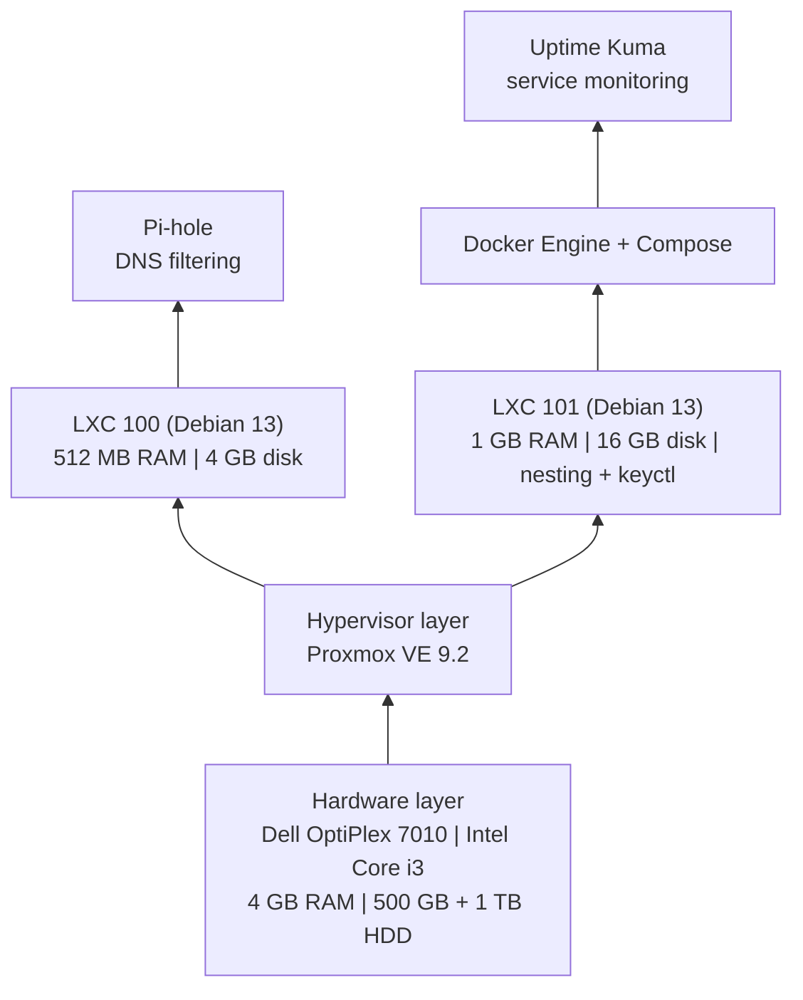

## What I built

1. **Proxmox VE install** on the 500 GB drive using ext4. ZFS was avoided because it uses too much RAM for a 4 GB machine.
2. **Repository fix and updates.** Disabled the paid enterprise repositories, enabled the no-subscription repository, and fully upgraded the system.
3. **Storage.** Formatted the 1 TB drive as an ext4 directory and used it for container disks, templates, and backups.
4. **Pi-hole** in an unprivileged LXC container for network-level DNS filtering, with query logging on.
5. **Docker** in an unprivileged LXC container (with nesting and keyctl enabled), installed from Docker's official apt repository.
6. **Uptime Kuma** (Docker Compose, SQLite) monitoring the Proxmox host, the Pi-hole DNS service, and the Pi-hole web dashboard.
7. **Backups.** Stop-mode backups of both containers with zstd compression.

## Verification

- Pi-hole resolves normal domains and returns `0.0.0.0` for a known ad domain:
  ```
  dig @10.0.0.35 google.com +short
  dig @10.0.0.35 doubleclick.net +short
  ```
- Test devices appear in the Pi-hole Query Log (phone at `10.0.0.32` and the Docker container).
- `docker run hello-world` succeeds inside the container.
- All three Uptime Kuma monitors report up.

## Problems and fixes

| Problem | Cause | Fix |
|---|---|---|
| `apt update` failed on first boot | Enterprise repositories need a paid subscription | Disabled them and enabled the no-subscription repository |
| Pi-hole NTP error: "Insufficient permissions" | An unprivileged container cannot set the system clock | Disabled Pi-hole's built-in NTP client; the container uses the host's clock |
| Queries from a test phone did not show in the log at first | Phone-side DNS settings were bypassing Pi-hole | Set DNS manually, disabled Private DNS and VPN for the test |
| Snapshots unavailable | Directory storage cannot snapshot container disks | Used full container backups instead |
| Router cannot hand out custom DNS | The Xfinity gateway does not expose a DNS setting | Set Pi-hole as DNS manually on individual devices |
| Risk of IP conflicts | Fixed addresses were inside the DHCP range | Moved the DHCP pool start to 10.0.0.100 |

## Design decisions

- **LXC over VMs:** containers share the host kernel, so each service costs a fraction of the RAM a VM would.
- **Unprivileged containers:** a container breakout would land as an unprivileged user, not root.
- **Pi-hole is a single point of failure for devices that use it.** If the host is off, those devices lose DNS. Accepted for a home lab.
- **Backups live on the same drive as the containers.** They protect against bad configs and updates, not drive failure.

## Next steps

- Copy backups to an external drive
- Add more RAM (the board supports up to 16 GB)
- Add more monitored services and alerts in Uptime Kuma
- Document a restore procedure and test it

## Screenshots

**Proxmox datacenter overview** (both containers running, host at about 49% RAM)

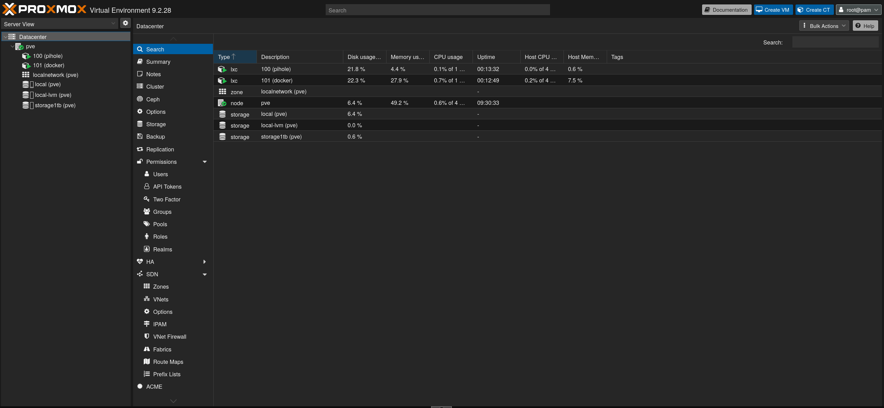

**Storage layout** (500 GB boot drive, 1 TB ext4 storage drive)

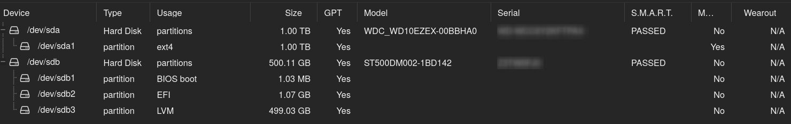

**Repositories** (enterprise disabled, no-subscription enabled)

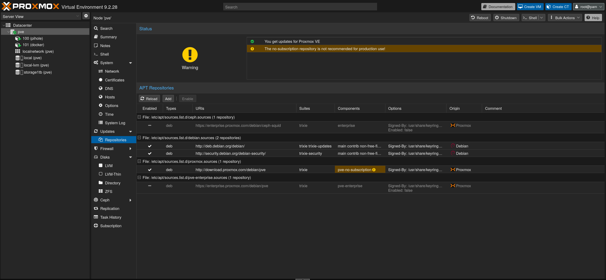

**Docker container options** (unprivileged, nesting and keyctl, start at boot)

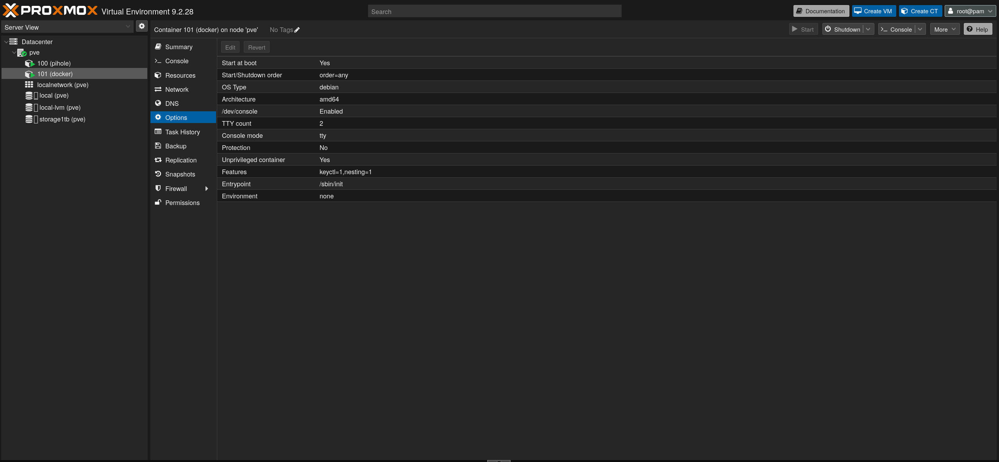

**Pi-hole dashboard** (clients, permitted and blocked domains)

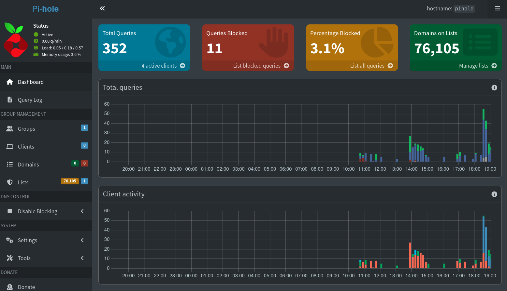

**Pi-hole query log** (queries from the Docker container)

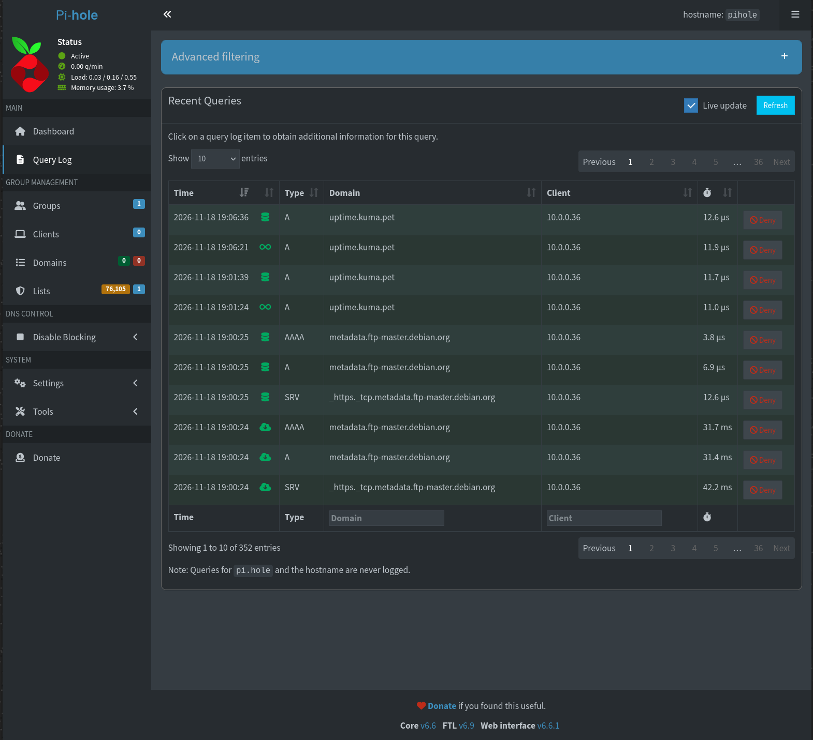

**DNS verification** (normal domain resolves, ad domain returns 0.0.0.0)

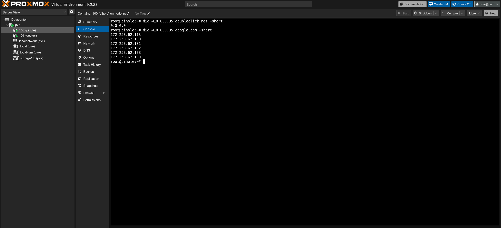

**Docker and Uptime Kuma running**

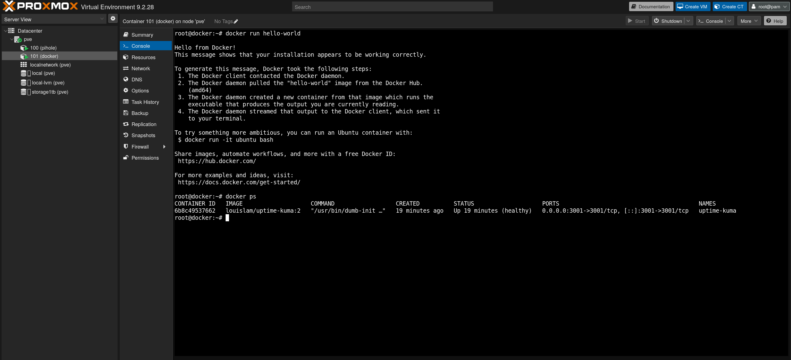

**Uptime Kuma monitors** (all three up)

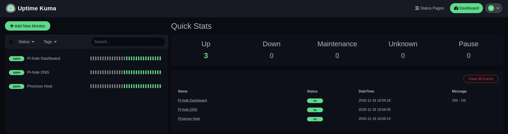

**Container backups**

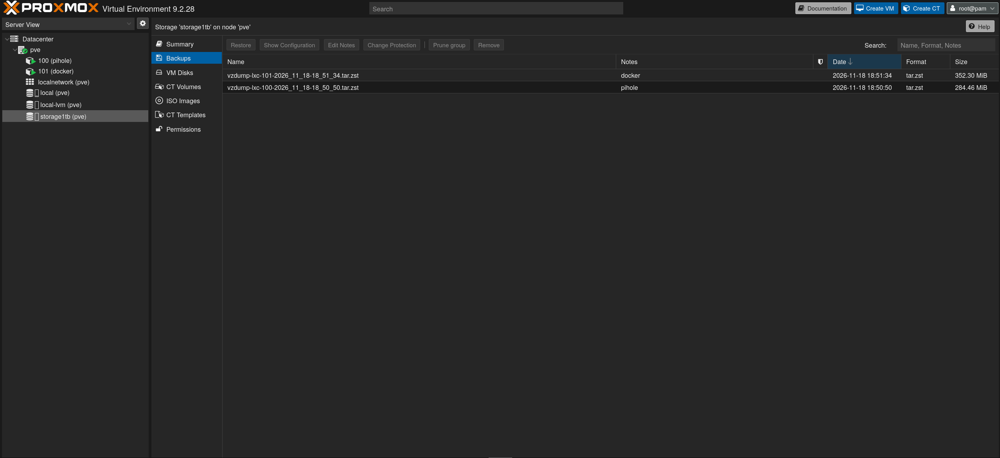
